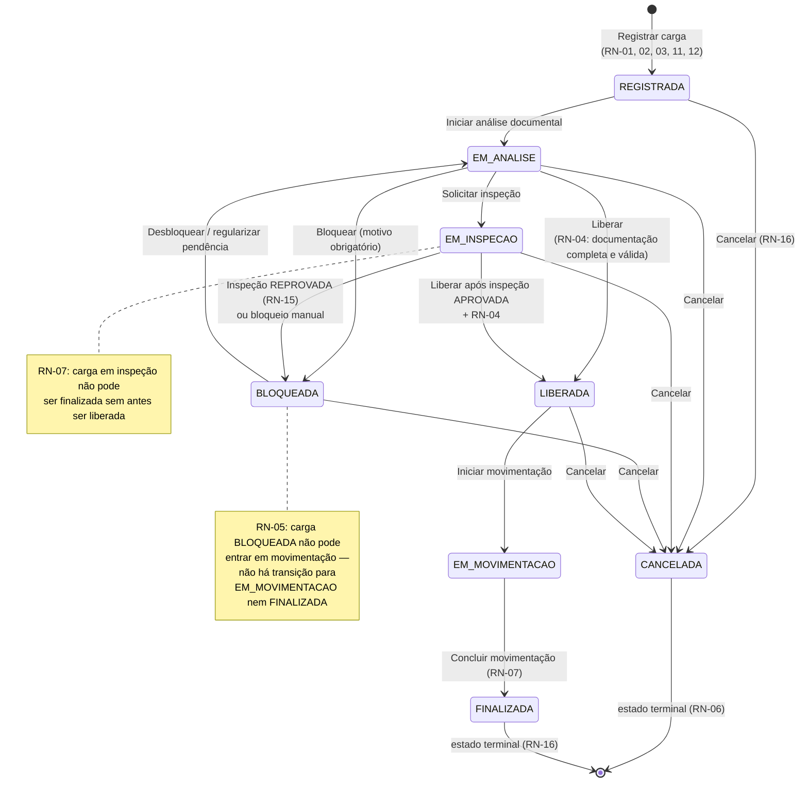

# Fluxo de Transição de Status da Carga Química *(obrigatório)*

Máquina de estados da `CargaQuimica`. Toda transição passa por `transicionarStatus()` na raiz do agregado, que valida o caminho permitido e registra um `EventoHistorico` (RN-13). Implementada em `src/domain/carga/StatusCargaMachine.ts`.

> **Atualização Fase 2:** o enunciado da Fase 2 prevalece sobre a modelagem inicial — `EM_VALIDACAO` foi renomeado para `EM_ANALISE`, o estado `EM_MOVIMENTACAO` foi adicionado entre `LIBERADA` e `FINALIZADA`, e `LIBERADA → CANCELADA` passou a ser permitida (decisão registrada em ADR-011).

## Tabela de transições (fonte de verdade para testes)

| # | De | Para | Gatilho | Regra(s) |
|---|---|---|---|---|
| T1 | *(início)* | REGISTRADA | Registrar carga | RN-01, RN-02, RN-03, RN-11, RN-12 |
| T2 | REGISTRADA | EM_ANALISE | Iniciar análise | — |
| T3 | EM_ANALISE | EM_INSPECAO | Solicitar inspeção | — |
| T4 | EM_ANALISE | LIBERADA | Liberar carga | RN-04 |
| T5 | EM_ANALISE | BLOQUEADA | Bloquear | motivo obrigatório |
| T6 | EM_INSPECAO | LIBERADA | Liberar pós-inspeção | inspeção APROVADA + RN-04 |
| T7 | EM_INSPECAO | BLOQUEADA | Inspeção reprovada / bloqueio | RN-15 |
| T8 | BLOQUEADA | EM_ANALISE | Desbloquear | motivo obrigatório |
| T9 | LIBERADA | EM_MOVIMENTACAO | Iniciar movimentação | — |
| T10 | EM_MOVIMENTACAO | FINALIZADA | Concluir movimentação | RN-07 |
| T11 | REGISTRADA / EM_ANALISE / EM_INSPECAO / BLOQUEADA / LIBERADA | CANCELADA | Cancelar carga | RN-16 |
| — | CANCELADA / FINALIZADA | *(qualquer)* | — | ❌ proibido (RN-06, RN-16) |
| — | BLOQUEADA | EM_MOVIMENTACAO / FINALIZADA | — | ❌ proibido (RN-05) |
| — | EM_INSPECAO | FINALIZADA | — | ❌ proibido (RN-07) |

> **Garantia de implementação:** a tabela acima está codificada em `StatusCargaMachine.ts` como estrutura de dados (`Record<StatusCarga, StatusCarga[]>`), e cada linha — permitida e proibida — tem teste unitário correspondente em `src/tests/unit/domain/StatusCargaMachine.test.ts` (71 testes, incluindo varredura exaustiva de todos os pares de estados).
